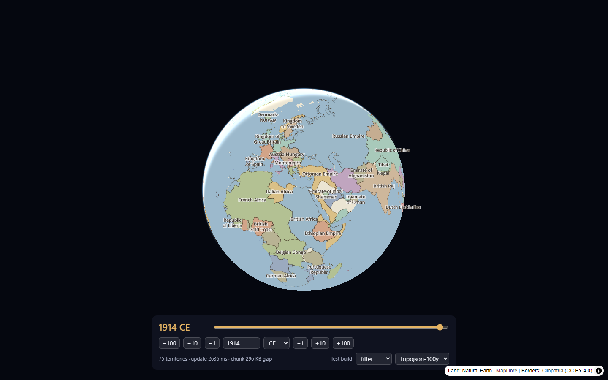

# Phase 0 results

**Date:** 2026-11-15
**Question:** Can a MapLibre globe show real Cliopatria borders and move smoothly through the years? If so, which data format, file size and update method should the real app use?



## Decisions

| Question | Decision |
|---|---|
| Globe engine | **MapLibre GL JS 6.16**, confirmed. The CesiumJS fallback isn't needed. |
| Data format | **TopoJSON**, which stores each shared border once. Files are about 10× smaller than GeoJSON. |
| File size | **One file per 100 years.** |
| Year update method | **setData**, which sends only the territories active in the chosen year to the map. |
| Simplification | **None.** The source data is already coarse (see finding 1). |

## Test setup

- **Machine:** this PC, with an NVIDIA RTX 3080 and a 165 Hz display, running Microsoft Edge headless with its real GPU (Direct3D 11) at 1440×900.
- **Network:** simulated at 25 Mbps down, 5 Mbps up and 40 ms latency, with the browser cache disabled. Files were served gzipped, as a normal host would serve them.
- **Phone proxy:** the same test with the CPU slowed 4×. This only approximates a phone's processor. It doesn't slow the GPU.
- **Timing:** a year change is measured from the request until the map has finished drawing. Results come in steps of about 6 ms because the display refreshes every 6.06 ms.
- **Code:** the test page is in `spike/` and the benchmark is `spike/bench/run-bench.mjs`. Two runs were made, and the tables say which run they come from.

## Results against the blueprint targets

Using the chosen setup: TopoJSON, 100-year files, setData.

| Target | Goal | Result | Verdict |
|---|---|---|---|
| Globe rotation | 60 fps on a typical laptop, 30+ on a mid-range phone | 165 fps, the display's maximum, at 1914 and 1250 | **Pass on this PC.** Not tested on a typical laptop or phone. |
| Year change, data loaded | Under 100 ms | 1900s: 85 ms median, 127 ms worst. 1000s: 36 ms. 500 BCE: 18 ms. | **Pass, apart from rare worst cases in the 1900s.** The phone proxy missed in the 1900s (133 ms median, 218 ms worst). |
| Year change, new 100-year file | Under 500 ms | 82 ms if already prefetched, 145 ms if not | **Pass** |
| First view on broadband | Under 3 s | 1.2 s | **Pass** |
| Largest file | Under 1.5 MB gzipped | 0.37 MB (1800s) | **Pass** |

## Data format and file size (run 1, setData)

| Variant | Total download for all years | Largest file | First view |
|---|---:|---:|---:|
| GeoJSON, 100-year files | 15.25 MB | 3.25 MB | 2.36 s |
| **TopoJSON, 100-year files** | **2.62 MB** | **0.37 MB** | **1.11 s** |
| TopoJSON, 50-year files | 3.13 MB | 0.24 MB | 1.10 s |

50-year files added 20% to the total download and made no measurable difference to speed, so 100-year files win on simplicity.

## Update methods (run 2, TopoJSON, 100-year files)

| | filter | **setData** | window (±25 years) |
|---|---:|---:|---:|
| How it works | Whole century loaded, layer filter picks the year | Only the year's territories loaded | ±25 years loaded and filtered, reloaded on leaving the window |
| First view | 3.36 s | **1.20 s** | 2.25 s |
| Year change, 1900s, median / worst | 67 / 85 ms | **85 / 127 ms** | 61 / **600 ms** |
| Phone proxy, 1900s, median / worst | 74 / 134 ms | **133 / 218 ms** | 73 / **1,273 ms** |
| Into a prefetched new century | **1,260 ms** | **82 ms** | 437 ms |
| Jump to an unloaded century | 229 ms | **145 ms** | 162 ms |

- **filter** has the fastest scrubbing, but it hands a whole century (up to 1,745 records) to MapLibre's tiler. That makes the first view slow, and every century boundary freezes the map for over a second.
- **window** has good medians, but it freezes for 0.6–1.3 s whenever it reloads, roughly every 50 years. That's worst during playback.
- **setData** has no bad outliers anywhere. Its cost follows the number of territories in the chosen year, which is at most a few hundred.

## Findings

1. **Simplification does nothing for this data.** Cliopatria's border points are about 23 km apart (median, sampled from the 1900s), so 1–2.5 km tolerances removed under 4% of them. Borders will look angular when zoomed in, and the zoom limit of level 6 should stay.
2. **TopoJSON is about 10× smaller.** Consecutive records of the same state repeat most of their borders. The 1900s file holds 777,550 border points but only 47,889 unique ones.
3. **Decoding TopoJSON takes up to 65 ms on this PC** for the heaviest centuries, on the main thread. That's probably around 250 ms on a slow phone, enough to stutter a rotation while the next century is prefetched. If real-device testing shows stutter, Phase 2 should decode in a background worker.
4. **Fast input is merged.** While one year renders, only the latest requested year waits. Dragging the slider therefore skips years instead of building up a backlog.
5. **MapLibre 6 setup notes:** it has named exports only. Its worker is loaded with `setWorkerUrl()` and a Vite `?url` import, and the globe is turned on with the style's `projection` property.
6. **Labels come from an external font server** (`demotiles.maplibre.org`). The real app should host its own fonts before launch.
7. **The known label errors are visible**, including "Denmark-Norway" and "Kingdom of Great Britain" in 1914 (blueprint section 3.2, Finding 4). The corrections system in Phase 1 is needed.
8. **The one error in the runs** was the browser asking for a `favicon.ico` that doesn't exist yet. It's harmless.

## Not tested yet

- **A typical laptop or a real phone.** This PC is far faster than the target devices, so this is the most important gap. To test on a phone on the same Wi-Fi network, run `npm run spike:dev -- --host` and open the "Network" address it prints.
- **Touch gestures, label crowding and hover quality.** These belong to Phase 2.
- **Year-zero handling.** The page skips year 0 correctly by design, but there are no automated tests yet. They're planned for Phase 1.

## Reproducing

```sh
npm install
npm run data:fetch
npm run data:spike -- --format=topojson --chunk=100
npm run spike:build
npm run spike:bench -- --variants=topojson-100y --methods=filter,setData,window
```
